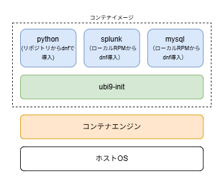
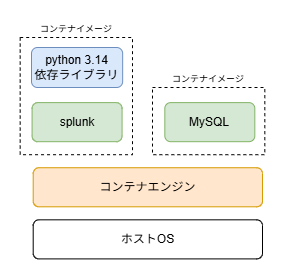
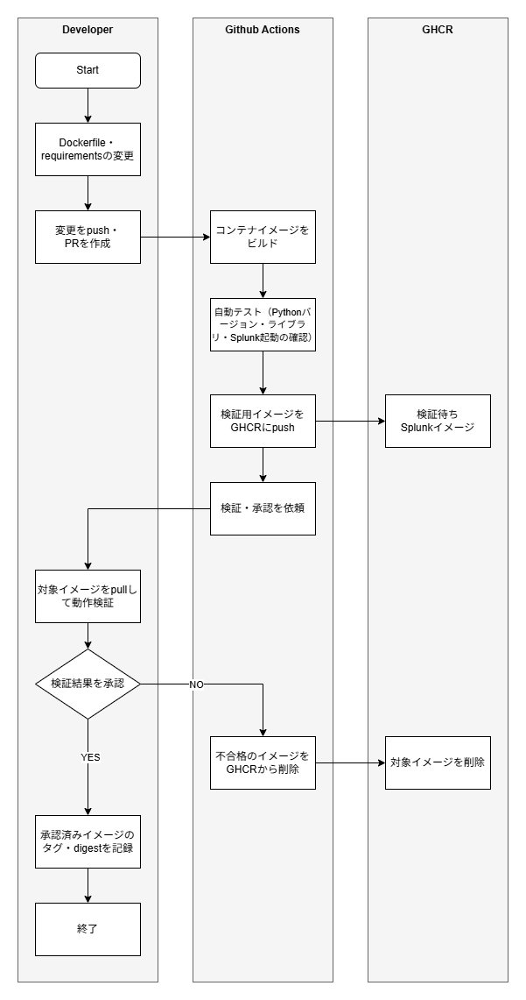

# Splunk検証環境のコンテナ構成見直しとGHCRによるイメージ管理

## 概要

[前回作成](https://github.com/yj-platform-lab/splunk-app-dev-environment/blob/main/README.md)したSplunk検証用イメージには以下の課題がある。

- 不要なファイルが残っており、イメージサイズに削減の余地がある
- SplunkとMySQLが同居しており、個別の起動・停止や更新が難しい

今後のFargate展開に向け、本記事ではコンテナ構成の見直しによる軽量化と、イメージの管理フローを整理する。

## **現行イメージと改善方針**

### 現行イメージ

現在は、UBI 9をベースにPython・Splunk・MySQLをまとめてインストールしている。
緑色は提供イメージ、青色はビルド時に追加するものを示す。

### 改善方針

改善後はSplunkとMySQLの提供イメージを利用し、コンテナを分離する。各イメージには実行に必要なOS由来のファイルが含まれるため、UBI 9を土台とした独自構築は不要となる。  
Python 3.14と依存ライブラリは、実行環境を固定するためSplunkイメージのビルド時に追加する。変更の多いアルバムアプリは、Compose側で配置する。

改善後のイメージは以下である

## Splunkイメージ運用フロー

Splunkイメージの運用フローを以下に示す。当初は承認後にGHCRへpushする方針だったが、承認待ちのイメージをGitHub ActionsのArtifactに保存すると、GitHub Freeの無料ストレージ枠を超える。  そのため、自動チェック後にGHCRへpushし、動作検証で承認されたイメージを後続で使用する。不合格のイメージは削除する。

なお、Splunkアプリのディレクトリはイメージに含めない。Pythonや依存ライブラリより変更頻度が高いため、アプリの変更でイメージを再ビルドせずに済むよう、Composeでコンテナを起動する際に配置する。

## MySQLイメージ運用フロー

MySQLは提供イメージをそのままGHCRへ保存するため、独自のビルドは行わない。データの投入はComposeでの起動時に行う。

## まとめ

SplunkとMySQLを別々のコンテナに分離し、提供イメージを利用する構成へ変更した。イメージサイズ（CONTENT SIZE）は、従来の3.67GBから合計約2.14GB（Splunk＋Python：1.88GB、MySQL：255MB）となり、約42％削減できた。

また、SplunkとMySQLを個別に起動・停止・更新できる構成とし、GHCRでのイメージ管理フローを整えた。次回はComposeでアプリを組み合わせ、Fargateへの展開を進める。
